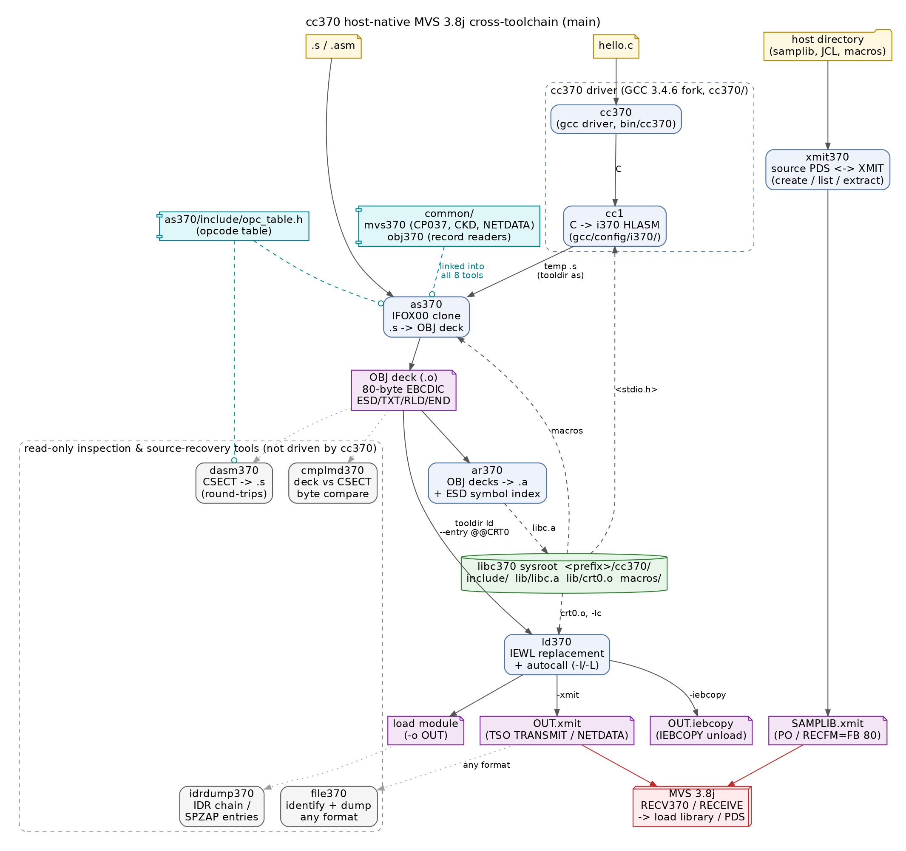

# Architecture

How the pieces of this repository fit together on `main`: one compiler driver,
eight standalone tools, one shared format library, and the libc370 sysroot they
build against. The on-the-wire formats themselves are documented in the other
files in `docs/`; this page is the map.

Source: [`diagrams/architecture.dot`](diagrams/architecture.dot) (Graphviz).
Re-render the PNG and SVG with `sh docs/diagrams/render.sh` after editing it.

## The build pipeline

`cc370 hello.c -o hello -flinker-output=xmit` runs, in order:

1. **`cc370`** — the GCC 3.4.6 driver (`cc370/gcc/gcc.c`, installed as
   `bin/cc370`). It finds its helpers by short name in its private tooldir
   `libexec/cc370/1.0.0/`: `cc1`, plus `as`, `ld` and `ar` symlinks to the real
   `as370`, `ld370` and `ar370` (`make install-tools`).
2. **`cc1`** — the compiler proper. The target backend is
   `cc370/gcc/config/i370/` (`i370.c`, `i370.md`, `mvspdp.h`); it writes
   fixed-column HLASM for IFOX00 with CP037 string data. Headers come from the
   sysroot's `include/`.
3. **`as370`** (`as370/src/as370.c`) — the IFOX00 clone. It assembles the temp
   `.s` into an OS/360 object deck (80-byte EBCDIC ESD/TXT/RLD/END cards).
   Macros are searched in `-I` dirs, then `$AS370_MACLIB`, then
   `<exedir>/../macros` (the sysroot's `macros/`).
4. **`ld370`** (`ld370/src/ld370.c`) — the IEWL replacement. The driver's
   `LINK_SPEC` (`mvspdp.h`) passes `--entry @@CRT0`, prepends `crt0.o`
   (`STARTFILE_SPEC`) and links `-lc`; ld370 autocalls unresolved symbols out of
   `.a` archives and writes the load-module member to `-o`. `-xmit` and
   `-iebcopy` (from `-flinker-output=xmit|iebcopy`) also write `OUT.xmit` (TSO
   TRANSMIT/NETDATA) and `OUT.iebcopy` (IEBCOPY unloaded PDS).
5. On MVS, one `RECV370` (or `RECEIVE`) step installs the XMIT into a load
   library. Nothing else in the build runs on the mainframe.

**`ar370`** (`ar370/src/ar370.c`, `ar370 rc ARCHIVE.a OBJ...`) builds the `.a`
archives ld370 autocalls against — including libc370's `libc.a` — with a GNU
`/` symbol table built from each deck's ESD.

**`xmit370`** (`xmit370/src/xmit370.c`) is the non-code half of a
distribution: `create` packs a host directory (samplib, JCL, macros) into a
TSO TRANSMIT of a PO/RECFM=FB 80 source PDS; `list`/`extract` read any XMIT.

## Read-only inspection and source-recovery tools

None of these is invoked by the driver; `make install` gives them PATH links
only.

| Tool | Reads | What it answers |
|------|-------|-----------------|
| `file370` | any format above | identifies a file by its leading bytes; `-v` dumps ESD/records/directory/INMR units |
| `cmplmd370` | OBJ deck + load module / DLIB element | is this deck byte-identical to that CSECT (adcons cleared with `--clearrld`, sections paired by name) |
| `dasm370` | OBJ deck | disassembles one CSECT to `.s` that as370 re-assembles to the same bytes |
| `idrdump370` | load module | walks the IDR chain and decodes HMASPZAP entries per CESD section |

`dasm370` includes as370's opcode table (`as370/include/opc_table.h`) instead of
a copy, so the decoder and the encoder cannot drift apart.

## Shared code

`common/` is compiled into every tool (the Makefile's `COMMON`):

- `common/src/mvs370.c` / `mvs370.h` — the byte layer: big-endian field access,
  CP037 tables, the CKD count field, NETDATA text units.
- `common/src/obj370.c` / `obj370.h` — the record layer, a reader only: the
  80-byte card stream (ESD/TXT/RLD/END) and the load-module record walk. Used by
  ld370, file370, cmplmd370, dasm370 and idrdump370.

## Tests

`make test` runs the host-side suites: `test-as370` (decks byte-identical to the
committed IFOX00 references), `test-listref` (`-a` listing vs IFOX00
SYSPRINT), `test-cc370` (codegen checks against `build/gcc/cc1`, needs `make
compiler`), `test-corpus`, and the xmit370, cmplmd370, dasm370, idrdump370 and
file370 suites. `sh ld370/tests/run.sh` is the ld370 suite (not wired into
`make test`). The as370 and listref suites read libc370's macro libraries from
a sibling checkout (`LIBC370=../libc370` by default). CI
(`.github/workflows/build.yml`) builds the tools with gcc and clang and runs the
as370, listref, ld370 and xmit370 suites; it does not build the GCC fork.
